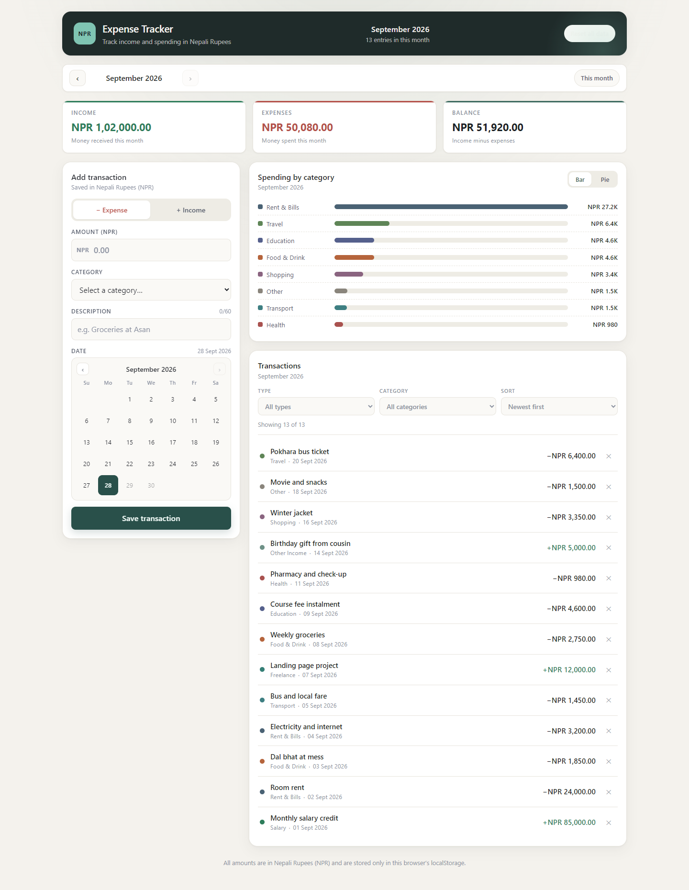
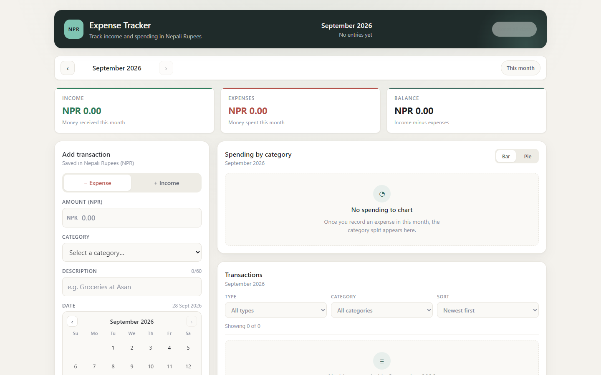
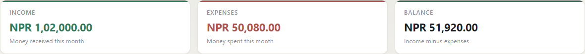
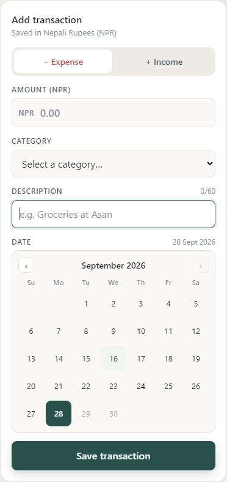
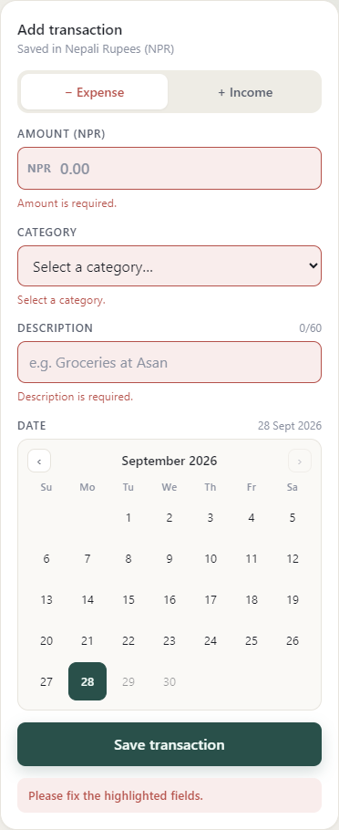
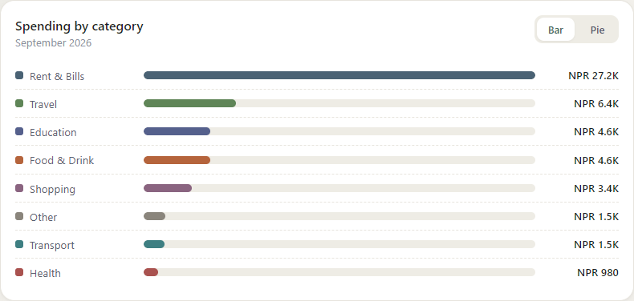
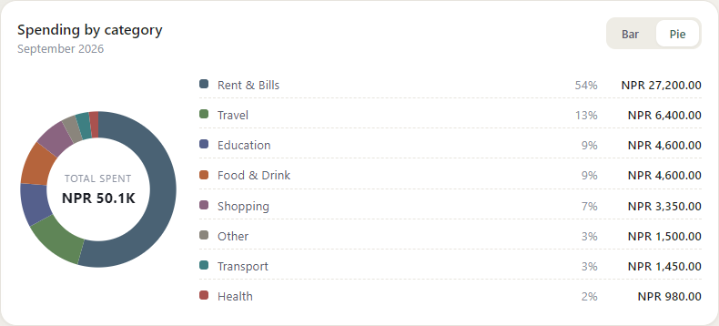
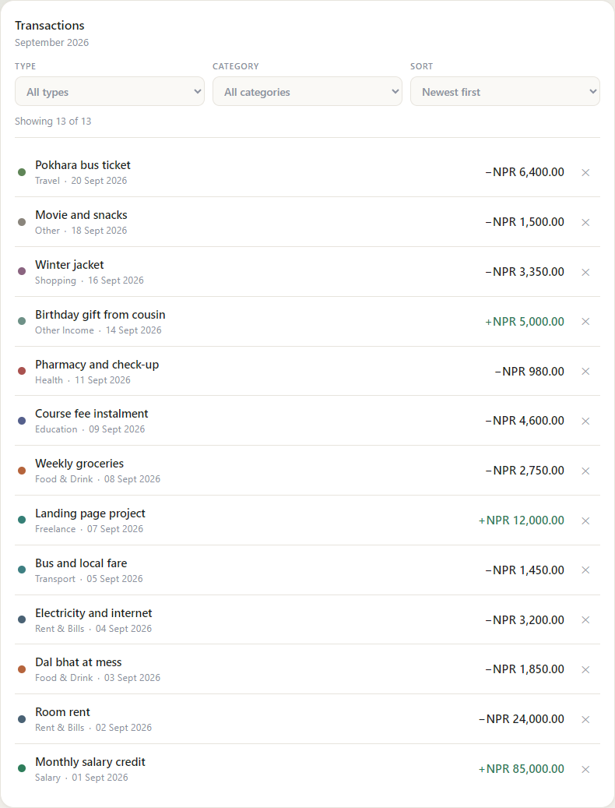
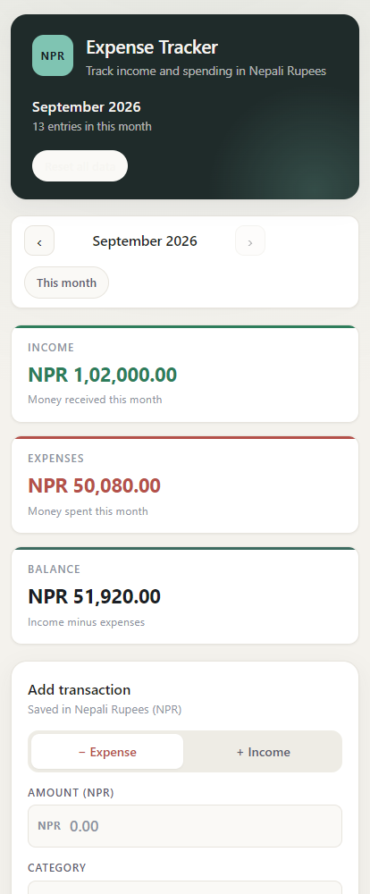

# Expense Tracker (NPR)

A simple, single-page **expense tracker** built with React. Log income and expenses in
Nepali Rupees, watch the running balance update instantly, filter and sort your entries,
and see where your money went with a bar / pie chart of spending by category. Everything
is stored in your browser's `localStorage`, so the data is still there after a refresh —
no server, no account, no database.



---

## Features

| # | Feature | What it does |
|---|---------|--------------|
| 1 | **Add transactions** | Controlled form for amount, type (income / expense), category, description and date. |
| 2 | **Running balance** | Live **Income − Expenses** balance for the month being viewed, with colour-coded summary cards. |
| 3 | **Calendar date picker** | A custom month calendar instead of a plain date input. Today is highlighted, future dates are disabled, and the month can be paged through. |
| 4 | **Input validation** | Every field is validated with a clear message. Amount must be a positive number capped at NPR 1,00,00,000; description must be 3–60 characters; the date cannot be in the future. |
| 5 | **Nepali Rupee formatting** | All money uses the lakh-crore grouping used in Nepal — `NPR 12,34,567.00`, not `NPR 1,234,567.00`. |
| 6 | **List with delete** | All transactions of the month, each removable with one click and an `aria-label` for screen readers. |
| 7 | **Filter & sort** | Filter by type and category, sort by date or amount, and clear filters in one click. |
| 8 | **Bar / Pie chart** | Spending split by category, toggleable between a bar chart and a donut chart. Built with plain CSS and SVG — no chart library. |
| 9 | **Monthly view** | Move between months with the arrows or jump back with "This month". Totals, chart and list all follow the selected month. |
| 10 | **localStorage persistence** | Data is written on every change and restored on load via a reusable `useLocalStorage` hook. |
| 11 | **Sample data** | A one-click demo data set so you can explore the app without typing 17 entries. |
| 12 | **Responsive & accessible** | Two-column desktop layout that collapses to one column on mobile; labelled controls, `role="alert"` errors and visible focus rings. |

---

## Screenshots

**1. Empty state** — nothing recorded yet, with a prompt to load the demo data.



**2. Dashboard** — summary cards, chart and transaction list for the month.


**2b. Summary cards** — income, expenses and balance. Money in is green, money out is red,
and a negative balance shows a minus sign.



**3. Add transaction form with the calendar date picker**



**4. Validation errors** — submitting an empty or invalid form.



**5. Bar chart and pie chart of spending by category**

| Bar chart | Pie chart |
|-----------|-----------|
|  |  |

**6. Transaction list with filter and sort controls**



**7. Mobile layout (414px)**



---

## Technologies Used

| Technology | Purpose |
|------------|---------|
| **React 19** (functional components + hooks) | UI and state management |
| **JavaScript (ES modules)** | Application logic |
| **Vite 8** | Dev server and production build |
| **HTML5** | Page structure |
| **Plain CSS** (custom properties, Grid, Flexbox) | Styling — no CSS framework |
| **SVG + CSS** | Chart rendering |
| **`Intl.NumberFormat` (`en-IN`)** | Nepali lakh-crore number formatting |
| **`localStorage`** | Client-side persistence |
| **ESLint** (`eslint-plugin-react-hooks`) | Code quality checks |

**No third-party UI, chart, form or state-management libraries** — only React, React DOM
and Vite. The chart, the calendar and the validation are all hand-written.

---

## Getting Started

### Prerequisites

- **Node.js 18 or newer** — check with `node -v`
- **npm** — ships with Node.js
- A modern browser (Chrome, Edge, Firefox or Safari)
- VS Code or any code editor (optional)

### Installation & Run

```bash
# 1. install dependencies
npm install

# 2. start the development server
npm run dev
```

Vite prints a local URL (by default <http://localhost:5173>). Open it in your browser.

### Other commands

```bash
npm run build     # build for production into dist/
npm run preview   # preview the production build locally
npm run lint      # run ESLint
```

### Screenshots were taken with

```bash
npm run dev -- --port 5180
```

at a 1440×900 desktop viewport and a 414×900 mobile viewport.

---

## How to Use

1. **Load sample data** (optional) — when the app is empty, click *Load sample data* in the
   transactions panel.
2. **Add an entry** — fill in the amount, pick a category, type a description and choose the
   date from the calendar, then press **Save transaction**. The dashboard jumps to the month
   the entry belongs to.
3. **Read the summary** — the three cards show total income, total expenses and the balance
   for the selected month. A negative balance is shown in red.
4. **Explore the chart** — switch between **Bar** and **Pie** to see spending by category.
5. **Review and prune** — filter by type or category, sort by date or amount, and delete
   anything you no longer need.
6. **Move between months** — use `‹` and `›`, or *This month* to jump back.

---

## Validation Rules

| Field | Rules |
|-------|-------|
| Amount | Required · numbers only · max 2 decimal places · greater than 0 · at most NPR 1,00,00,000 |
| Type | Required · must be `income` or `expense` |
| Category | Required · must be one of the categories for the selected type |
| Description | Required · trimmed · between 3 and 60 characters |
| Date | Required · a real calendar date · not in the future · on or after 01 Jan 2000 |

Errors appear under a field once it has been touched, or immediately after a submit attempt,
and a submit attempt with errors never adds a transaction. The amount field also filters out
non-numeric characters as you type.

---

## Categories

Spending is split into eight categories and income into three. The eight expense colours sit
at a similar lightness and warmth so the bar and donut charts read as one calm set rather
than a rainbow, and income stays in the green family so colour itself signals "money in".

| Expense category | Colour | | Income category | Colour |
| --- | --- | --- | --- | --- |
| Rent & Bills | slate `#4a6274` | | Salary | deep green `#2e7d5b` |
| Food & Drink | terracotta `#b5643c` | | Freelance | teal `#357f76` |
| Transport | dusty teal `#3e7f82` | | Other Income | soft sage `#6e9187` |
| Education | muted indigo `#55608c` | | | |
| Shopping | muted plum `#8a6480` | | | |
| Health | brick `#a9524f` | | | |
| Travel | sage `#5f8557` | | | |
| Other | warm grey `#8a857c` | | | |

Categories are defined in one place, [`src/utils/categories.js`](src/utils/categories.js). If
a browser still holds data saved under an older, narrower category name, that id is mapped
onto the closest category that exists today rather than being discarded.

---

## Project Structure

```
expense-tracker/
├── docs/
│   ├── screenshots/                    # images used in this README and the project document
│   └── Expense-Tracker-Project-Documentation.docx
├── src/
│   ├── components/
│   │   ├── Calendar.jsx          # month-grid date picker
│   │   ├── CategoryChart.jsx     # bar / donut chart + legend
│   │   ├── EmptyState.jsx        # shared "nothing here" panel
│   │   ├── FilterBar.jsx         # filter + sort controls
│   │   ├── Header.jsx            # page header
│   │   ├── MonthNav.jsx          # previous / next month navigation
│   │   ├── SummaryCards.jsx      # income / expense / balance cards
│   │   ├── TransactionForm.jsx   # controlled form + validation display
│   │   ├── TransactionItem.jsx   # a single list row
│   │   └── TransactionList.jsx   # filtered, sorted list
│   ├── context/
│   │   ├── ExpenseContext.js     # createContext + useExpenses hook
│   │   └── ExpenseProvider.jsx   # state owner, persists to localStorage
│   ├── data/
│   │   └── sampleTransactions.js # demo data with dates relative to today
│   ├── hooks/
│   │   └── useLocalStorage.js    # useState + localStorage sync
│   ├── utils/
│   │   ├── calendar.js           # month keys, month grid, month shifting
│   │   ├── categories.js         # categories and their colours
│   │   ├── format.js             # NPR + date formatting
│   │   └── validation.js         # validation rules and amount sanitiser
│   ├── App.jsx                   # page composition and derived data
│   ├── index.css                 # all styling
│   └── main.jsx                  # entry point, mounts <ExpenseProvider>
├── index.html
├── vite.config.js
├── eslint.config.js
├── package.json
└── README.md
```

**Folder purpose**

- `components/` — reusable, presentational React components.
- `context/` — Context API: one shared transaction list instead of prop drilling.
- `hooks/` — reusable stateful logic.
- `utils/` — pure helper functions (formatting, dates, validation, categories).
- `data/` — static demo data.
- `docs/` — documentation assets.

---

## Design Notes

- **A deliberately small palette.** One warm neutral background, one ink scale, one accent
  teal, and a green / red pair reserved for money in and money out. Nothing else gets a
  colour of its own.
- **Eight expense categories, not seventeen.** An earlier version had twelve expense and
  five income categories with a distinct hue each, which made the chart read as a
  rainbow. The categories are now merged down to the ones a student budget actually has
  (Rent & Bills absorbs utilities, Food & Drink absorbs groceries) and the eight expense
  colours sit at a similar lightness and warmth, so the chart reads as one calm set.
- **Older data is kept, not discarded.** Because the category list shrank, the removed ids
  are mapped onto the closest category that exists today (`rent` → `housing`,
  `groceries` → `food`, and so on), so a browser that already had data saved does not
  suddenly show everything as "Other".
- **Warm paper background** with one soft wash of accent light, so the white cards lift
  off the page without heavy shadows.
- **Tabular numerals** on every amount, so digits line up in columns and the balance is
  easy to scan.
- **No chart library.** The bar chart is a list of divs with percentage widths; the donut is
  one SVG circle per category using `stroke-dasharray` and `stroke-dashoffset`.
- **Dates are plain `YYYY-MM-DD` strings**, which makes month grouping a `slice(0, 7)` and
  ordering a string comparison — no timezone surprises.

---

## Known Limitations

- **Data lives in one browser only.** Clearing site data or opening the app on another
  device or browser starts from an empty state. There is no server or sync.
- **No authentication or accounts.** Anyone using the browser sees the same data.
- **No editing of an existing entry** — a mistake means deleting and re-adding.
- **No budget limits or alerts** (a stretch goal in the assignment that was left out to
  keep the scope small).
- **No multi-currency** — the app is fixed to NPR.
- **No automated test suite committed to the repository.** Behaviour was verified by driving
  the running app in a real browser — 53 end-to-end checks covering validation, filters,
  sorting, deletion, persistence, month navigation, the calendar, both charts and the
  palette — plus a geometry check at seven viewport widths. Those scripts are not part of the
  project, so `npm test` does not exist. ESLint and the production build run clean.

---

## Future Enhancements

- A monthly budget per category, with a warning when it is exceeded
- An automated test suite using Vitest and React Testing Library
- Edit an existing transaction instead of delete + re-add
- Import / export transactions as CSV or JSON
- Recurring transactions (rent, salary) generated automatically each month
- Custom user-defined categories
- A dark theme toggle
- Grouping by Nepali (Bikram Sambat) months
- Deploy to Vercel / Netlify / GitHub Pages

---

## Project Documents

- [`README.md`](README.md) — this file.
- [`docs/Expense-Tracker-Project-Documentation.docx`](docs/Expense-Tracker-Project-Documentation.docx)
  — the project document, covering every section of the course documentation
  blueprint and formatted as an APA 7 paper: 29 pages, Times New Roman 12 pt,
  double-spaced, with six figures, six tables, and twelve code listings. Replace
  the five bracketed placeholders on the title page with your own details
  before submitting.

## License

ISC
